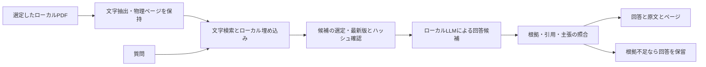

# Local RAG PoC — 根拠を確認できる社内資料検索

**Project owner: [dachone-sys](https://github.com/dachone-sys)**  
社内イントラの「目的の手順書を見つけにくい」という課題から着想し、質問に対する回答と、根拠となる資料名・原文・PDFページを一緒に確認するPoCを開発しています。

このリポジトリは、その技術を説明するために整理した公開版です。**会社名・社内URL・社内資料・実データの検索インデックス・社内画面は含みません。** 同梱の例はすべて架空です。PoC段階の取り組みであり、全社導入や本番運用の実績を示すものではありません。

## 私の取り組み・担当範囲

- 利用者として既存のキーワード検索の課題を発見し、チーム向けのRAG PoCを企画。
- 「自然文で質問できる」「回答の根拠を確認できる」「根拠がなければ回答を保留する」「ローカル処理を優先する」という要件を設定。
- AI支援を活用して、資料取り込み・検索・根拠付き回答・資料選定画面を備える試作を進め、実際の使いやすさに合わせて改善。
- 根拠不足、資料の更新・旧版、手順書の読み取り、回答の詳しさと速度を検証項目として改善を進める。

企画・要件設定とAI支援を利用した開発プロセスを含む個人の取り組みです。手書きのみで全コードを実装したという主張ではありません。勤務先の名称、運用構成、実資料に基づく結果は公開対象に含めていません。

## 技術的な見どころ

| 課題 | 実装・設計 |
|---|---|
| 文字の一致だけでは関係の薄い資料が混ざる | 日本語の文字bigramを含むBM25形式の検索と、ローカル埋め込みの順位をRRFで統合 |
| 回答がどの資料に基づくか分からない | 根拠IDを検査し、引用が原文に存在することを照合。物理PDFページへのリンクを表示 |
| 根拠にない条件・数字が追加される | 構造化出力、根拠照合、数字・英字表現の検査、ローカルLLMによる再検証を組み合わせる |
| 資料が古くなった・書き換わった | manifestによる選定、旧版の除外、SHA-256の照合で回答対象を再確認 |
| 一部のPDFページを読み取れない | 読み取り不足がある資料を検索対象から外し、確認対象として記録 |
| 社内テキストの送信を抑えたい | AI接続先をループバックに固定。HTTPプロキシを使わずリダイレクトも拒否 |

ハルシネーションを完全になくす保証はありません。引用が原文と一致していても、質問に対する解釈が正しいとは限らないため、回答と原文を利用者が確認する設計です。

## 構成



Python標準HTTPサーバー / HTML・JavaScript / pypdf / pdfplumber / ローカルのOpenAI互換HTTPインターフェース / Windows DPAPI（任意のキャッシュ）を使用します。OpenAIのクラウドAPIへの接続やAPIキーは必要ありません。

## すぐに動かす：架空資料のシナリオデモ

Python 3.12を推奨します。次のモードは標準ライブラリだけで動きます。

```sh
python app.py serve --port 8765
```

ブラウザーで http://127.0.0.1:8765 を開きます。

- 「経費精算はどこから申請する？」：架空の根拠を表示。
- 「打刻を忘れた場合の修正方法は？」：架空の根拠を表示。
- 「経費申請の期限はいつまで？」：根拠がなく回答を保留。

**この起動方法は固定シナリオのUIデモです。LLM生成や意味検索の動作を示すものではありません。** 本リポジトリにはモデル、モデル起動プログラム、実PDFを同梱していません。資料選定画面は資料を設定した場合に利用します。

## ローカルLLMとつなぐ場合

生成用を `127.0.0.1:11434/v1`、埋め込み用を `127.0.0.1:11435/v1` で起動してください。生成用は `chat/completions` のJSON Schema出力、埋め込み用は `embeddings`、両方に `models` が必要です。すべてのOpenAI互換サーバーでの動作を保証していません。モデルとランタイムの用意・利用条件の確認は別途必要です。

```sh
python app.py serve --sample-ai --model YOUR_LOCAL_MODEL_ID --local-ai-only-confirmed
```

`--embed-model YOUR_LOCAL_EMBEDDING_ID` を加えると、架空資料の埋め込み検索も使います。認証する場合はローカルサーバー側と同じ値を環境変数 `RAG_AI_KEY` に設定します。秘密値をリポジトリに保存しないでください。

任意のローカルPDF取り込みには `python -m pip install -r requirements.txt` を実行します。`python app.py build --help` でオプションを確認してください。入力manifestの `documents` は各資料の `file`, `title`, `status: current`, `sha256`, `local_user_access: true` などを保持します。自分で利用権限を持つ資料のみで試してください。インデックスは原文を含むため、このリポジトリの外の非同期フォルダに保存します。

## 公開版の検証

```sh
python -m unittest discover -s tests -v
```

固定デモの根拠表示・回答保留、無効な根拠ID、改変された引用、資料変更後の除外を架空データで検証します。これは本番環境の品質評価ではなく、LLMの精度・速度のベンチマークでもありません。検証範囲は [VALIDATION.md](VALIDATION.md) に記載します。

## 制約と今後の検証

- 単一PC用PoC。マルチユーザー認証や組織の権限連携は未実装です。
- 画像だけのPDFのOCRは別途必要です。表の抽出はレイアウトに依存します。
- 根拠照合には保守的なルールがあり、答えられる質問でも保留する場合があります。
- 情報漏洩が一切起きない保証や、企業向けセキュリティ認証を示すものではありません。
- 本番化には評価用質問セット、検索・回答品質、アクセス制御、更新運用などの検証が必要です。

## ファイル案内

- `app.py`：検索、PDF取り込み、根拠検査、ローカルHTTPサーバー。
- `answer_engine.py`：手順・表の候補抽出と回答検証。
- `index.html` / `sources.html`：質問と根拠表示、資料選定の画面。
- `secure_cache.py`：Windowsユーザーに紐づく暗号化キャッシュ補助。
- `tests/`：架空データによる回帰テスト。

**公開者・企画主体：dachone-sys**  
本ページは本人のポートフォリオです。勤務先の公式発表・推奨・導入事例ではありません。
